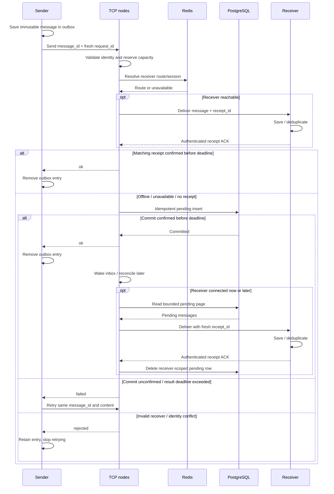

# Message delivery

**At least once; no strict ordering; one active connection/user.**

## Flow

| Result | Meaning / client action |
| --- | --- |
| `ok` | Receiver ACK or PostgreSQL commit; remove outbox entry |
| `failed` / no response | Delivery may have happened; retry the same identity |
| `rejected` | Invalid input/receiver or identity conflict; retain entry, stop retrying |

`ok` does not imply read, completed offline delivery or durable client storage.
Redis stores presence/routes; PostgreSQL stores pending messages, not history.
Pending rows do not expire.

## Identity & recovery

- Identity: `(authenticated sender_id, message_id)`. Retries retain receiver/payload
  and use a fresh `request_id`; UUIDs are canonical lowercase.
- Receivers save/deduplicate before ACK. Same content is ACKed again; conflicts are not.
- ACKs must match sender/message, receipt, authenticated receiver and connection session.
- Fallback rejects changed content for an existing pending identity; direct delivery
  relies on immutable retries and receiver deduplication.
- Lost wakeups are recovered by bounded reconciliation, targeting a ~30s scan cycle.
  Inbox cursors wrap; unacknowledged messages remain retryable.
- ACK/insert races and confirmed late commits can leave an extra pending copy;
  inbox recovery delivers it again. Commit confirmation precedes Redis wakeup.
- Expired writes never start; unconfirmed persistence stays retryable. Admission
  permits remain held until queued frames are consumed/discarded or running work exits.

Temporary presence-renewal failures preserve the socket within its confirmed lease.
New sends return `failed/unavailable` until renewal recovers; ping and ACK remain
allowed. Lease expiry or ownership loss closes the socket.

## Editing

Use `ChatchatClient.edit_message(client, receiver_id_or_pid, message_id, text)`.
It returns `{:ok, message_id}` after queueing, replaces local pending content for
that identity and destination, and automatically retries like `send_message/3`.
Changing the destination of a local pending identity is rejected. Superseded
attempt results cannot confirm the replacement.

Send `edit_message` with `message_id`, receiver `user_id`, `message`, and a fresh
UUID `request_id`. Receiver frames also use `edit_message`, with the ordinary
message fields: `from_user_id`, `message_id`, `message`, `inserted_at`, and
`receipt_id`. Results and receipt ACKs are unchanged. Sender identity comes from
authentication; the backend does not check that an original message exists.

Edits use direct receipt-or-commit delivery. PostgreSQL fallback atomically
replaces matching pending content (including earlier edits/deletion notices), or
inserts an edit if no row exists. A different pending receiver is rejected.
Identical pending edit retries preserve their timestamp; changed content advances
it. Ordinary content retries cannot overwrite a pending edit. Stored ACK cleanup
matches the delivered kind and timestamp so an old ACK cannot delete replacement
content. No message history or extra edit identity is retained.

Application clients reconcile edits, originals and deletions using server-generated
`inserted_at`. Delivery remains unordered and at least once. Direct delivery does
not replace older database rows; these and already transmitted frames can arrive
later. Delayed retries can supersede newer content; this ordering is accepted.
The mock receiver only validates, logs and ACKs edits, without changing its inbox.

Apply the edit-kind migration and upgrade TCP nodes and receivers before enabling
edit sends. Older receivers do not understand `edit_message` frames.

## Deletion

Send `delete_message` with `message_id`, receiver `user_id`, and a fresh UUID
`request_id`. Sender identity comes only from authentication. The server returns
`message_result` with the same receipt-or-commit statuses, but deletion always
commits before success. It atomically replaces matching pending content with a
`message_deleted` notice, or inserts a notice when content is already delivered.
A different receiver for an existing pending identity is rejected.

Receivers get `from_user_id`, `message_id`, and `receipt_id`, and confirm using
`message_delivered_ack`. Notices survive offline receivers and retry until ACK.
Old content ACKs cannot remove a pending deletion notice. Deletion is idempotent;
the backend stores pending work, not message history, so it cannot verify ownership
of an already delivered UUID beyond the authenticated sender namespace.

Stop retrying original content when deleting. Receivers must retain a deletion
tombstone for `(from_user_id, message_id)` before ACK, including unknown messages,
and ignore/ACK late content: delivery remains unordered and at least once.
After deletion ACK, the backend retains no tombstone; stale content retries can
reach the receiver again. The mock client only logs and ACKs deletion notices;
implementing local deletion/tombstones is outside its scope.

## Mock clients

Stores survive socket reconnect, but **process stop/crash destroys inbox, outbox and
deduplication**. Inbox memory grows for the process lifetime; wrappers replace dead
clients with empty stores. Delivery retries use 1–30s base backoff plus up to 20%
jitter. Transient `presence_unavailable` reconnects; uncorrelated protocol errors
suspend sends until `ChatchatClient.resume/1`.

Inspect with `ChatchatClient.outbox/1` and `ChatchatClient.inbox/1`.
Use `ChatchatClient.delete_message(client, receiver_id_or_pid, message_id)` for a
single deletion attempt. It logs the backend result and returns `{:ok, message_id}`
or `{:error, reason}`. Retry failures manually with the same message ID. Active
outbox entries return `{:error, :message_pending}` to prevent content retries
racing with deletion.

## Default bounds

| Limit | Value |
| --- | --- |
| Newline-delimited JSON frame, excluding newline | 4,096 bytes |
| Authentication / idle / socket send timeout | 5s / 60s / 1s |
| Direct window / transmissions | 2s / at most 2 |
| Server result / client response / database budget | 8s / 10s / at most 5s |
| Sender attempts per node / connection | 409 / 16 |
| Receiver reservations per node / connection | 682 / 16 |
| Sender / receiver / inbox byte budget | 8 MiB each per node |
| Database workers / maximum inbox workers / inbox page | 32 / 64 / 16 rows |
| Wake ingress / pending receivers / retry timers / cursors | 4,096 each |
| Client outbox / inflight attempts / read page | 128 / 16 / 128 |
| Concurrent simulations | 16 |

Wire reference: `/admin/tcp-protocol`. Deployment: [README](README.md#tcp-load-balancing).
