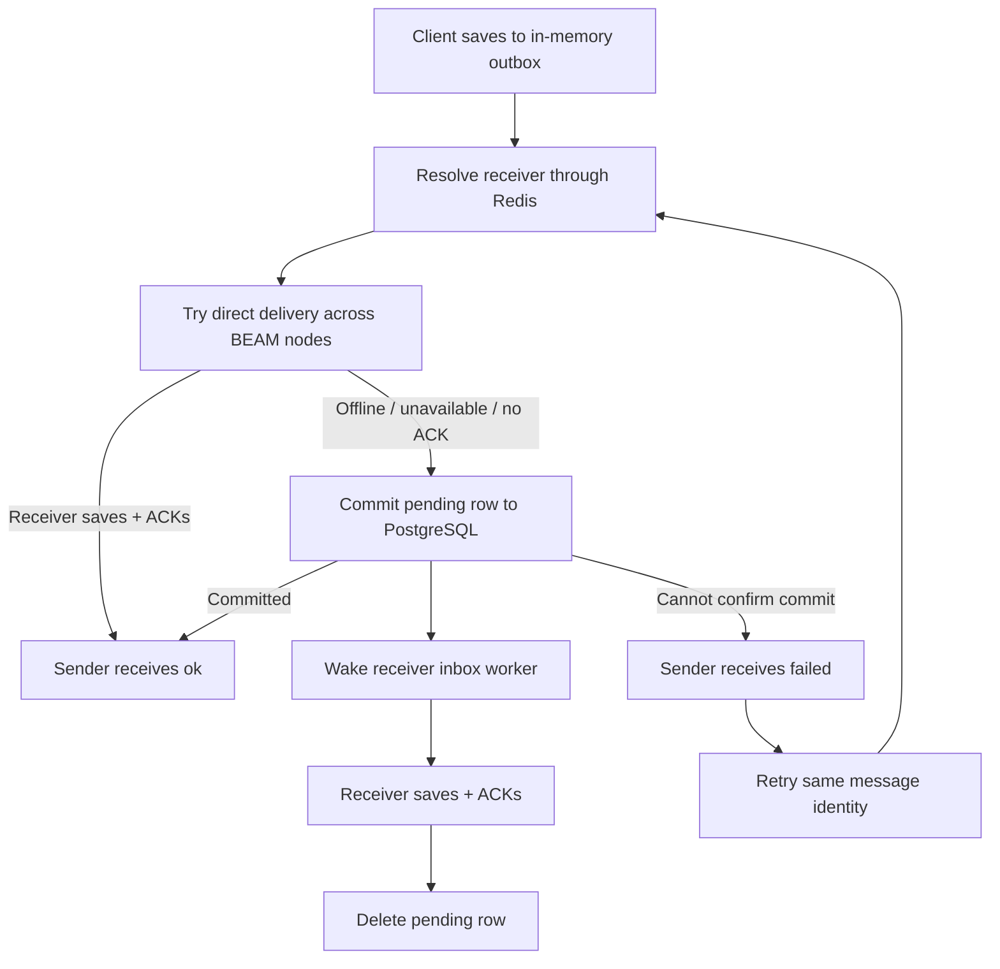
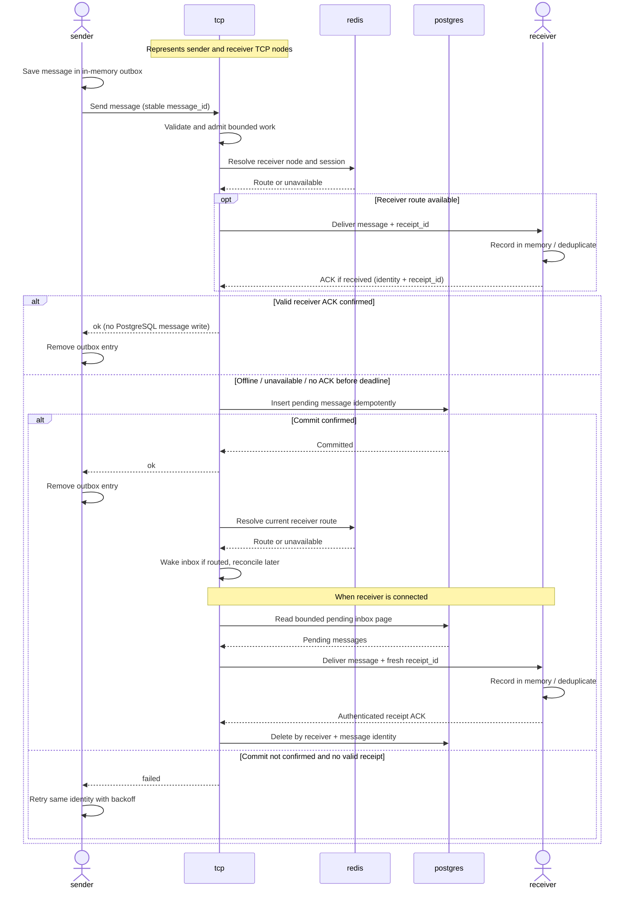

# Message delivery

**At least once. No strict ordering. One active connection per user.**

## Flow

| Result | Meaning | Client action |
| --- | --- | --- |
| `ok` | Receiver ACK or PostgreSQL commit | Remove outbox entry |
| `failed` | Capacity/unavailability; delivery may have happened | Retry |
| No response | Unknown outcome | Retry after timeout |
| `rejected` | Invalid request/receiver or identity conflict | Retain entry; stop retrying it |

**`ok` does not mean read, offline delivery completed, or client disk durability.**
Redis holds routes only. PostgreSQL holds pending messages, not conversation history.
Undelivered rows do not expire.

## Sender → receiver

## Identity & recovery

| Rule | Behavior |
| --- | --- |
| Message identity | `(authenticated sender_id, client message_id)` |
| Retry | Same receiver, payload, and message UUID; fresh request UUID |
| Fallback insert | Same stored content is idempotent; changed content is rejected |
| Receiver duplicate | Record once, ACK again; changed content never ACKs |
| ACK authority | Exact identity, receipt, authenticated receiver, and session |
| Lost inbox wakeup | Reconciliation revisits connected receivers about every 30s |
| Unacknowledged row | Cursor wraps and retries; stuck rows do not block newer rows |
| ACK/insert race | A committed extra copy remains eligible for inbox delivery |
| Timestamp | Backend metadata; fallback retries preserve stored time; direct attempts use fresh time |

Direct delivery makes no PostgreSQL message queries. It relies on the sender reusing immutable
content and receiver deduplication; conflicts with pending rows are checked only on fallback.

## Mock clients

- Save outbox before send; save inbox/deduplication before ACK.
- Retry indefinitely with 1–30s backoff plus jitter.
- Reconnect preserves state; **process stop/crash clears everything**.
- Inbox/deduplication grows in memory for the client's lifetime.
- Uncorrelated protocol errors suspend sends until explicit `resume`.

| Inspect/control | API |
| --- | --- |
| Pending/rejected sends | `ChatchatClient.outbox(client)` |
| Received messages | `ChatchatClient.inbox(client)` |
| Resume after fixing protocol error | `ChatchatClient.resume(client)` |

## Protocol & limits

Full wire reference: [`/admin/tcp-protocol`](http://localhost:4000/admin/tcp-protocol).
Frames are newline-delimited UTF-8 JSON; authenticate first. UUIDs are canonical lowercase.
Frame limits include JSON escaping and envelope fields. Sender identity comes from authentication.

| Bound | Value |
| --- | --- |
| Encoded frame, excluding newline | 4,096 bytes |
| Authentication / idle / socket send timeout | 5s / 60s / 1s |
| Direct window / transmissions | 2s / at most 2 |
| Server result / client response timeout | 8s / 10s |
| Database operation timeout | At most 5s |
| Sender attempts per node / connection | 409 / 16 |
| Receiver reservations per node / connection | 682 / 16 |
| Sender / receiver / inbox byte budgets | 8 MiB each per node |
| Database workers / inbox workers | 32 / 64 |
| Inbox page | 16 rows |
| Wake ingress / pending receivers / timers / cursors | 4,096 each |
| Client outbox / inflight / read page | 128 / 16 / 128 |
| Concurrent simulations | 16 |

Admission reserves capacity **before payload enqueue**. Queued frames keep permits until
consumed/discarded or the handler dies. Running writes keep reservations until exit;
confirmed late commits still wake inbox recovery. Persistence uses one absolute deadline
checked inside the worker and before each write/query; a busy database pool refuses
checkout instead of retaining an expired waiter. Unconfirmed outcomes stay retryable,
and commit acknowledgement precedes Redis wakeup. Delivery supervision restarts producers
and coordinators together to preserve budgets.

Deployment: [TCP load balancing](README.md#tcp-load-balancing).
